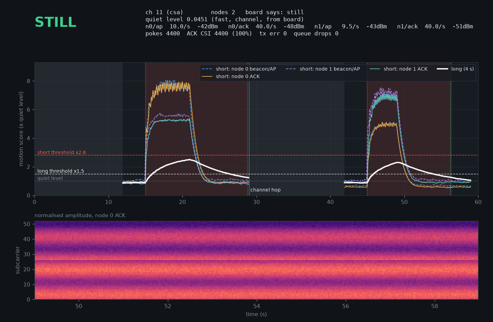

# ackwave: ESP32 Wi-Fi CSI Motion Sensing


Detects human motion in a room using **Wi-Fi Channel State Information (CSI)**, with no camera and no wearable. An ESP32-S3 measures how the radio channel between itself and your existing router changes over time. A person moving changes the multipath reflections, so the per-subcarrier amplitudes start to fluctuate. The detector runs **on the board itself**, so the sensor works unplugged from a PC (with an optional piezo buzzer), and a live GUI shows what is happening when it is plugged in.



## Quick start

Everything runs from one script in the project folder. Plug the board in, then:

```bash
cd ackwave
./csi              # menu: pick what you want
```

| Command | What it does |
|---|---|
| `./csi gui` | **Live view.** It also logs everything in the background, just like `record`. Close the window to stop; the summary is printed and saved. |
| `./csi record` | **Log motion with clock times, no window** (e.g. overnight or while you're out). The PC stays awake; **Ctrl+C** stops it and prints a summary. |
| `./csi history` | **Look back** at the last session: a zoomable timeline and a list of motion periods. `./csi history --list` shows all sessions; `./csi history 11-08` opens the one from 8 Nov. |
| `./csi demo` | The GUI on fake data, no board needed |
| `./csi flash` | Build and flash the firmware (uses ESP-IDF v5.3.2 at `~/esp/esp-idf-v5.3.2`) |
| `./csi test` | Run all tests |
| `./csi shortcut` | Add **CSI Motion** to the desktop app menu (opens the live view) |

Only one program can read the board at a time: close the GUI before recording, and stop a recording before opening the GUI. The script says so if the board is busy or unplugged.

Sessions from both `gui` and `record` are saved to `sessions/` in the project folder: `events-<start>.log` is readable text with clock times, and `raw-<start>.log.gz` holds all the data (about 55 MB per hour).

**In the GUI:** the badge shows `CALIBRATING`, `STILL` or `MOTION`.
- **Top plot:** both scores as multiples of the room's quiet level, with the thresholds as lines. The **30 s / 2 min / 10 min** buttons (or keys 1/2/3) choose how much it shows.
- **Session timeline:** everything since the GUI opened, on a clock. It shows the peak score each second, motion periods in red, brief blips as orange ticks and calibration in grey.
- **Pause** (or the space bar) freezes the view so the toolbar's zoom and pan tools work. Logging carries on, and **Live** goes back. Calibration takes about 10 s after power-up; keep still for it, or press the board's **BOOT** button to recalibrate (it waits 5 s so you can step away).

**First-time setup** (already done on this PC): `python3 -m venv .venv && .venv/bin/pip install -r requirements.txt`.

## How it gets a steady CSI stream: "Polite Wi-Fi"

Routers send beacons only about 10 times a second, and on 2.4 GHz they often send them at 1 Mbps (802.11b). That format has no OFDM training field, so it produces no CSI. To get a dense, steady stream without joining your network, the board uses a quirk found by [researchers at the University of Waterloo](https://uwaterloo.ca/computer-science/news/is-wifi-too-polite): **every Wi-Fi device ACKs a unicast frame addressed to it before checking who sent it.**

The board sends the router a 24-byte Null data frame (default 100/s) at **6 Mbps OFDM**. The router answers with an OFDM ACK, and that ACK carries a full 64-subcarrier channel estimate. No password or association is needed, and the airtime cost is tiny.

The Null frame's sender address is **made up**, not the board's own MAC. The ESP32's radio consumes ACKs addressed to itself and never reports CSI for them, but an ACK to an address it doesn't own is reported like any passing frame. Each AP gets its own made-up address (the board's MAC with the locally-administered bit flipped, plus the AP's index in the last byte), so the ACK's receiver address (`dmac`) says exactly that it answers our poke and which AP sent it. Frames from other devices can't be mistaken for ACKs. On a real ESP32-S3 this gives about 97 ACK CSI per second from 100 pokes. A **probe mode** logs every callback so this can be verified on your hardware (see [Bring-up](#bring-up-probe-mode)).

Pokes are split evenly over the APs being poked, so a far AP that rarely answers costs the router ACKs: learning a second AP at -82 dBm once dropped the router from 97 to 43 ACK/s. So an AP leaves the rotation when its beacons average below -80 dBm (it rejoins above -77) or when it answers under 20 % of a 50-poke window. A silent AP still gets 1 poke in 50 so it can come back, and if every AP on the channel is out, the strongest is poked anyway, so a single far router works as before. Each AP's state is printed in the `GATE` line every 5 s.

> Only point this at your own router. The firmware pokes only access points whose SSID matches `MY_SSID` (set in `main/my_network.h`).

## Architecture

```
 router ──beacons──────────────► ESP32-S3 (station mode, never associates)
        ◄──Null frame (6 Mbps)── poke_task   100/s, round-robin over good APs on this channel
        ──ACK (OFDM)───────────►
                                 promisc_cb  beacons: learn BSSIDs by SSID, follow CSA hops
                                 csi_cb      classify: AP frame / ACK / drop → queue
                                 control     the only task that changes channel
                                 print_task  serial line + on-board motion detector → buzzer
                                     │
                         USB serial (921600)
                                     ▼
                tools/gui.py      live plots     tools/analyze.py   text output
```

### Motion detector (`csi_core.h`, mirrored in `analyze.py`)

Per stream (node × beacon/ACK), for every packet:

1. Take the LLTF amplitudes and drop the DC and guard subcarriers, leaving **52 values**, then divide by their mean, which **cancels AGC gain jumps**.
2. **Band-pass** each subcarrier to about 0.3–5 Hz, the range of human movement. This drops the static multipath and most of the measurement noise: on a real board, about 60 % of the raw variation in a still room is noise above 10 Hz.
3. Track the energy of that signal over a **short window (0.5 s)** and a **long window (4 s)**.
4. Score = root of the mean energy of the **8 most active subcarriers**, so a movement that only touches a few subcarriers isn't averaged away.

The **short window** reacts within a fraction of a second to clear movement. The **long window** catches weak but sustained movement, which noise can't imitate for 4 s. Motion is reported if either window crosses its threshold, with hysteresis. **Which streams decide:** the ACK stream of each AP. An AP's own frames only count while it has no live ACK stream (e.g. with `POKE_HZ=0`): they are sparse, mixed traffic, and on one router that sends many of them they alone caused 8 of 14 false starts in a session. Device links never decide. What one packet can add to the long window is capped, so a big burst can't hold it on for long. Everything is time-based, so a 10 Hz beacon stream and a 100 Hz ACK stream score alike.

**Router glitches and scans are ignored.** Some routers briefly switch to a different channel shape and then snap back. One ISP-supplied gateway did this every 20 min 2 s, around the clock, for 0.1–1 s each time (shape jumps of 0.53–0.62). Each packet's normalised shape is compared to a 1 s average of the recent ones, and a packet that differs by more than 0.4 is skipped: people moving, even right next to the board, stayed at 0.39 or below. A new shape that lasts 5 s is accepted as real, for example when the board is moved.

Another gateway runs a background channel scan every 20 min 2 s (and in irregular bursts some nights). For 3–5 s its ACKs stop in ~175 ms gaps while it is on other channels, and come back with a milder shape jump of 0.26–0.34, which used to score as an 11–13× "movement". People never stop the ACKs (the largest gap during real movement was 56 ms), so the gap gives the scan away: for 2 s after an ACK gap over 100 ms (and 4× the usual spacing) the limit drops to 0.2, for as long as the switched shape lasts but never past 5 s after the gap. Meanwhile the router's own frames don't take over the decision. On one night's capture this caught 51 of 52 scans and took the strong (≥6×) events from 51 down to 5 (two router switches with no gap at the right moment, three brief blips), while walks and waves were found unchanged. Movement away from a scan keeps the normal 0.4 limit.

**Doppler view (experimental).** A moving body makes every subcarrier ripple at its Doppler frequency, about 16 Hz per m/s on 2.4 GHz. `tools/doppler.py` takes the last 1 s of the router's ACKs every 0.25 s, keeps the three strongest patterns common to all subcarriers (PCA) and shows their spectrum in the GUI, with a rough speed. On real captures walking put ~40 % of its energy under 3 Hz and spread the rest up to ~20 Hz for as long as it lasted, a waving hand sat at ~2–10 Hz, and router scans were a single 1 s blob with 73–95 % of the power under 3 Hz: a step, not a movement. Duration and shape tell them apart more than frequency alone. It does not affect the verdict yet. `python tools/doppler.py sessions/raw-….log.gz 07:07:20 07:08:20` prints it for part of a recording.

**Breathing (experimental).** `tools/breathing.py` looks for a steady 8–36 /min rhythm in the last 40 s of the router's ACKs (three strongest common patterns, drift removed) and rates it clear / possible / none by how far it stands above the background and how many subcarriers agree. In a first test someone standing still about 1 m from the board, on the line to the router and behind a wall and a full wardrobe, breathing at a counted 10 /min, read 9–12 /min "clear" the whole time; the same spot sitting normally and the empty room read "none". Asleep a few feet behind the board, off that line, nothing was found. It needs someone still and near the path, lags by up to 40 s, and does not affect the verdict. `python tools/breathing.py sessions/raw-….log.gz 10:46:30 10:47:40` prints it for part of a recording.

### Auto-calibration

Thresholds are **multiples of the room's quiet level** (short ×2.8, long ×1.4), and the board measures that level itself:

- **The quiet level** is the 10th percentile of the short-window score over the last 2 minutes, sampled 10 times a second. The short score drops back to the quiet level in every brief pause, so this works **even while someone is moving around**.
- **At boot** it measures for about 10 s (`CALIBRATING`, no verdict), then follows the measurement directly while the 2-minute history fills.
- **Afterwards it keeps tracking**, motion or not. It can fall immediately but rise at most 1 % per second, so constant activity isn't quickly learned as background, and a board moved somewhere noisier can't get stuck in "motion".
- **It recalibrates by itself** after a channel change, or when the signal strength steps by more than 4 dB and stays there. Moving the board does that; a person walking past only causes a brief dip.
- **The BOOT button** (`CAL_BUTTON_GPIO`, GPIO 0) recalibrates on demand, starting 5 s after the press so you can step away.

On a real ESP32-S3 the still room peaked at 2.0× (short) and 1.1× (long) the quiet level. A person moving scored 5–7× (short), and lighter movement 1.6–1.9× (long). In a quiet hour the long score stayed under 1.1× 99 % of the time, while small movements of a person lying down, confirmed by a mmWave sensor next to the board, reached 1.2–1.5×. That is why the long threshold is 1.4×.

The C and Python versions are tested against each other on synthetic and real captures: scores agree to within 10⁻⁶, and verdicts and calibration events match exactly.

## Testing without hardware

All protocol and decision logic lives in [`main/csi_core.h`](main/csi_core.h), which has no ESP-IDF dependencies, so it runs on a PC.

| Suite | What it covers |
|---|---|
| `test/test_core.c` | 249 checks: beacon/IE parsing (truncated, reordered, hidden SSID), CSA validation, Null-frame builder, made-up poke address, ACK classifier (dmac match, foreign frames, window, one-ACK-per-poke, 32-bit wrap), wrap-safe timeouts, poke round-robin and gating (RSSI hysteresis, yield windows, trial pokes, strongest fallback), device slots, device list from data frames, PC commands, detector (band-pass scores, top-K, hysteresis of both windows, long-window cap, quiet-level percentile, tracking limits and clamps, recalibration delay, RSSI-step detection), serial format, plus a 200,000-frame fuzzer (beacon and data-frame parsers), all under AddressSanitizer + UBSan |
| `tools/test_pipeline.py` | End to end on synthetic multipath CSI (beacons at 10 Hz + ACKs at 40 Hz, plus malformed lines) in five scenarios: calibration → motion → channel hop → motion; **motion during calibration**; **board moved** (RSSI step → one recalibration); **board moved somewhere noisier** without an RSSI change (must not get stuck in motion, and the quiet level must converge to the new spot's); and **two real captures** from an ESP32-S3 (`test/data`: a still room, which must give no motion, and a person moving). Checks detection within 1 s, release within 10 s, no false motion, and **C vs Python agreement** on every run |
| `tools/test_probe_report.py` | The bring-up report on a synthetic probe log |
| `tools/test_gui.py` | GUI state tracking, reboot handling and rendering (headless) |
| `tools/test_devices.py` | device lines, OUI lookup (all three database formats), stationary check, poke modes, dropping silent devices, re-sync after a board reboot, device links kept out of the verdict |
| `tools/test_record.py` | The session recorder's event log and summary, with a fake clock |

```bash
pip install -r requirements.txt
make test        # all of the above
make demo        # text analyzer on fake data
make gui-demo    # live GUI on fake data, paced in real time
make gui         # live GUI on the board
make record      # log motion with clock times until Ctrl+C
```

The firmware builds with **ESP-IDF v5.3.2 for ESP32-S3 with zero warnings**. CI builds three configurations (default, probe + passive buzzer, beacons-only + active buzzer).

## Running on hardware

Requires ESP-IDF v5.x and an ESP32-S3.

1. Set your network name: `cp main/my_network.h.example main/my_network.h` and edit it (or just run `./csi flash`, which asks). That file is git-ignored, so your network name is never committed. No password is needed: the board never joins the network.

   Other settings are at the top of `main/main.c`:

   | Setting | Default | |
   |---|---|---|
   | `MAX_CH` | 13 | use 11 in the US |
   | `POKE_HZ` | 100 | ACK pokes per second; 0 = beacons only |
   | `CSI_PROBE` | 0 | 1 = log every callback (bring-up) |
   | `BUZZER_GPIO` | -1 | piezo pin; -1 = no buzzer |
   | `BUZZER_ACTIVE` | 0 | 0 = passive piezo (PWM tone), 1 = active buzzer |
| `BUZZER_HZ` | 2700 | motion-beep pitch; find your buzzer's loudest with `BEEP,700,<hz>` |
| `BUZZER_SOFT_HZ` | 2000 | pitch of the quieter status sounds |
| `BEEP_AFTER_MS` | 2000 | beep once motion has lasted this long (skips brief blips); 0 = at once |
   | `CAL_BUTTON_GPIO` | 0 | button that recalibrates (BOOT on most boards); -1 = none |
   | `CAL_DELAY_S` | 5 | after a press: time to step away before measuring |
   | `LED_GPIO` | 48 | on-board RGB LED (WS2812); 38 on DevKitC-1 v1.1; -1 = none |
   | `LED_BRIGHT` | 40 | LED brightness for motion, 1-255 |
   | `MD_ON_SHORT` / `MD_ON_LONG` | 2.8 / 1.4 | thresholds as multiples of the quiet level; lower = more sensitive |

   Any of these can also be set at build time without editing, for example `CSI_DEFS="CSI_PROBE=1" idf.py build`.
2. Build and flash: `idf.py set-target esp32s3 build flash`
3. Watch it live (close `idf.py monitor` first, since only one program can hold the port):
   ```bash
   python tools/gui.py /dev/ttyUSB0        # or COM5 on Windows
   ```
4. After boot, keep the room still for about 15 s while it shows `CALIBRATING`. It's fine if someone moves now and then; it settles within a minute or two either way. Press **BOOT** to recalibrate at any time, for example after rearranging the room. If you get false alarms, raise `MD_ON_SHORT`/`MD_ON_LONG`; to catch smaller movements, lower them. The GUI shows the scores as multiples of the quiet level, so you can see the margins directly.

### Devices on your network (experimental)

The GUI opens a second window listing the devices the board hears talking to your network (only your `MY_SSID`), with their maker from the [`oui`](https://github.com/Ringmast4r/OUI-Master-Database) tool's database if installed (`~/.oui-database/`), else the system IEEE list (`ieee-data` / `arp-scan`). Each device is judged after 3 minutes of watching: a **stationary** one has a real (not private) MAC, actually transmits, is stronger than -80 dBm and keeps a steady signal.

Poke modes: **Auto** (default) pokes up to 4 stationary devices as extra sensing links, **All active** pokes the 4 busiest ones (phones included), **Manual** pokes exactly what you tick, **Off** pokes only the router. A poked device that stops answering is dropped for 30 minutes. Picks are sent to the board over USB while it runs (no reflash), the board refuses any MAC it hasn't seen on your network, and the GUI re-sends them after a board reboot. Your mode and picks are kept in `sessions/devices.json`.

Only the router link decides motion / still; device links are plotted dotted for comparison. Realistic expectations: the ESP32-S3 is **2.4 GHz only**, so devices on 5 GHz never appear, and devices asleep in power save mode don't answer pokes. On a mesh router that steers most clients to 5 GHz, expect few usable devices.

**Placement matters more than any setting.** The board is most sensitive along the line between it and the router, and close to either device. Place it so the area you want to watch lies between the two.

### Recording (any length, e.g. overnight)

```bash
make record          # or: python tools/record.py [port] [--out DIR] [--no-raw]
```

It finds the board, keeps the PC from sleeping while it runs, and reconnects if the board is unplugged. It writes a readable log with clock times to `sessions/events-<start>.log` in the project folder (`03:12:45  MOTION started (short x4.2, long x1.9)` … `still again after 17 s`), and the full data to `raw-<start>.log.gz` (about 55 MB per hour) for later analysis. Press **Ctrl+C** to stop: it prints a summary of every motion period. Blips shorter than 2 s are listed separately; in testing they came about 5 times an hour and mostly matched no other sensor, so treat them as noise unless they cluster. `make gui` opens the live GUI on the board; close it first, since only one program can use the port.

### Running unplugged

The detector runs on the board, so it works from any USB charger or power bank. The on-board RGB LED shows its state: **red** = motion, dim **blue** = calibrating, dim **yellow** = looking for the router, **off** = still. It flashes **white** for half a second at power-on. With a buzzer, each event has its own sound:

High and loud = something is happening, soft and falling = settling down, low = a problem.

| Sound | Meaning |
|---|---|
| rising chirp | powered on |
| one soft tick | recalibrate button / PC command received: step away |
| two soft blips | calibrated, watching for motion |
| one loud beep | motion that has lasted 2 s (brief blips stay silent) |
| soft falling pair (dee-doo) | that motion ended |
| low three-step fall | lost the router (once per loss) |
| soft rising pair (doo-dee) | found the router again | Serial output just goes nowhere.

If the LED stays dark, your board has it on another pin: build with `CSI_DEFS="LED_GPIO=38"` (ESP32-S3-DevKitC-1 v1.1).

### Buzzer (optional)

Wire a **passive piezo** between a free GPIO (GPIO 4 is a good choice; avoid strapping pins 0, 3, 45, 46 and USB pins 19, 20) and GND, then set `BUZZER_GPIO 4`. For an **active** buzzer (one that beeps on plain DC, usually sold with a voltage range like 3-24 V), also set `BUZZER_ACTIVE 1`; mind its polarity (+ to the GPIO). Many "active" buzzers are much louder driven with a tone at their resonance than with plain DC: try `BUZZER_ACTIVE 0` and a pitch sweep with `BEEP,700,<hz>` (one OSEPP 3-24 V buzzer peaked around 4250 Hz). The easiest place for these is `main/my_network.h`, which is included first and stays out of git:

```c
#define BUZZER_GPIO   4
#define BUZZER_ACTIVE 1
```

A piezo can't be detected electrically, so the buzzer is opt-in. If the pin can't be set up, the board prints `BUZZER,error,...` and carries on sensing.

### Bring-up: probe mode

The ACK path depends on chip and driver behaviour that can only be confirmed on real hardware. Build with `CSI_PROBE=1`, capture a minute of output, and run the report:

```bash
python tools/probe_report.py probe.log
```

It cross-references ACKs seen by the sniffer with CSI callbacks by radio timestamp. It reports whether ACKs produce CSI, what MAC/dmac the driver reports for them, the delay distribution with a suggested `ACK_WIN_US`, and how accurate the classifier is. It also counts ACKs sent to other devices, which shows whether control frames reach the sniffer at all.

## Serial protocol

```
ME,<board mac>
LEARNED,<idx>,<bssid>
CHANNEL,<ts_us>,<ch>,<csa|scan|lost>
CSI,<ts_us>,<node>,<kind 0=AP 1=ACK>,<ch>,<rssi>,<sig_mode>,<cwb>,<len>,<b0 b1 ...>   int8 [imag, real] pairs, LLTF
STATE,<ts_us>,<motion|still>,<short×1000>,<long×1000>     on-board verdict changes
CALIB,<ts_us>,<wait|collect|fast|track>,<boot|button|rssi|channel>,<quiet×1e6>,<short_thr×1e6>,<long_thr×1e6>
                                                 on every calibration change and every 5 s
STATS,<ts_us>,<pokes>,<tx_err>,<ack_csi>,<ap_csi>,<dropped>,<queue_full>,<poke_replies>   every 5 s
                                                 (ME, LEARNED and GATE are repeated just before it)
GATE,<idx>,<beacon_rssi>,<yield_pct|-1>,<pokes>,<ok|weak|silent>   per poked AP / device, every 5 s
POKING,<idx>,<mac>                               devices being poked (nodes 8..11), every 5 s
DEV,<mac>,<rssi>,<frames_sent>,<frames_received>,<ms_since_heard>   devices on our network, every 5 s
UNPOKED,<mac|all>   REFUSED,<mac>,<not-seen-on-network|is-an-ap|full>   REFUSED,bad-command
BUZZER,<off|gpioN|error,...>
LED,<off|gpioN|error,...>
BUTTON,<gpioN|error,gpioN|recalibrate|recalibrate,pc>
PROBE,...                                        only with CSI_PROBE=1
```

Commands to the board (one per line on the USB port; the GUI sends them):

```
POKE,<mac>      poke a device heard on our network (up to 4)
UNPOKE,<mac>    stop;  UNPOKE,all  stops all
CAL             recalibrate, like the BOOT button
BEEP[,<ms>[,<hz>]]  test beep (1-3000 ms, default 300; pitch 100-10000 Hz)
```

## Project layout

```
├── main/
│   ├── csi_core.h          pure logic: parsing, ACK classifier, motion detector
│   └── main.c              ESP-IDF firmware
├── test/
│   ├── test_core.c         host-side C tests + fuzzer
│   ├── score_lines.c       runs the C detector on a log (C/Python cross-check)
│   └── data/               real captures (still room, person moving) used by the tests
├── tools/
│   ├── gui.py              live GUI (+ device list window)
│   ├── devices.py          device names (OUI), stationary check, which to poke
│   ├── analyze.py          text analyzer + Python detector
│   ├── record.py           session recorder: readable motion log + summary
│   ├── probe_report.py     hardware bring-up report
│   ├── fake_csi.py         synthetic data generator
│   └── test_*.py           Python tests
└── docs/gui.png
```

## Limitations

- Detects motion *presence* only, with no localisation or activity classification. Device links (experimental) are the first step toward telling "near the board" from "near the router".
- The quiet level is measured automatically, but the threshold multipliers come from one room and position. If you get false alarms or miss movement, adjust `MD_ON_SHORT`/`MD_ON_LONG`.
- Right after a (re)calibration during constant movement, sensitivity is reduced for up to about 30 s. Moved somewhere noisier without a change in signal strength, the board may report motion for up to about 1.5 minutes while the quiet level catches up (BOOT skips that).
- Anything that moves continuously for minutes without pauses (a fan, curtains) slowly becomes part of the background. You are still detected on top of it.
- Breathing-scale movement is at the edge of what this can see; heartbeat is out of reach with ESP32 CSI.
- The ACK path is confirmed on one ESP32-S3 and router (100 % of sniffed ACKs produced CSI, 100 % classifier precision). Other chips or routers may differ, so run probe mode once on new hardware.
- Some routers answer unassociated stations with deauthentication frames. These are harmless here, but they add a little traffic.

## License

MIT, see [LICENSE](LICENSE).
