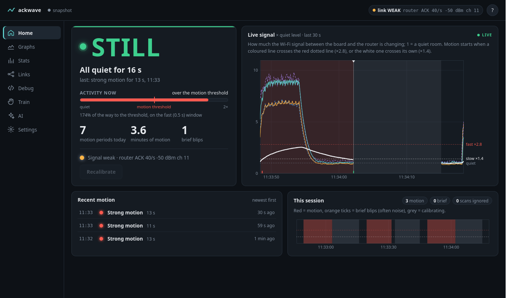

# ackwave: Wi-Fi motion sensing that never joins your network

**An ESP32-S3 senses movement through your router's Wi-Fi signal, without a password and without connecting.** It "politely" pokes the router about 100 times a second, and every acknowledgement it gets back carries a fresh measurement of the radio channel (Wi-Fi CSI). People moving change that channel. No camera, no wearable, no client on your network.

The detector runs **on the board itself**, so it works from a phone charger with an LED and optional sounds. A live GUI shows the details when it's plugged into a PC.



## What makes it different

Most ESP32 CSI motion sensors, such as [ESPectre](https://github.com/francescopace/espectre) and Espressif's [esp-csi](https://github.com/espressif/esp-csi) examples, **join your Wi-Fi** with its password and then create traffic (pings) so that frames carrying CSI keep arriving. ackwave takes another route:

- **It never joins your network.** No password, no IP address, nothing stored on the router, no new client in its device list. You only tell it the network's *name*. It gets its CSI by "politely" poking the router: Wi-Fi devices acknowledge a frame before checking who sent it, and every acknowledgement carries a fresh channel measurement ([how](#how-it-gets-a-steady-csi-stream-polite-wi-fi)).
- **A steady 100 measurements a second**, whatever the network is doing, measured on the router's own transmissions.
- **More sensing paths for free.** It can poke your other always-on devices too (a smart plug, a speaker). Each one adds a link across the room, with nothing to install on them.
- **Decides on the board.** The detector runs on the ESP32 itself and works from a phone charger: LED colours and optional sounds. It ignores the router's periodic background scans, which otherwise look like movement, and stays quiet when its link is too weak to trust.
- **Switch routers without reflashing.** The board scans for networks and you pick one in the GUI. The choice is saved on the board.
- **A lab GUI.** Live scores against the thresholds, a Doppler view, a breathing-rate estimate, link health, and logs of every session for later analysis. The C detector and a Python twin are tested to give the same answers.
- **Several boards, still on no network.** Boards find and poke each other (links across rooms) and send their verdicts, sealed with a key per board, to one hub board on USB, whatever channel each one watches ([below](#several-boards-and-home-assistant)).
- **A Home Assistant add-on.** The dashboard in HA's sidebar, behind HA's login, with the hub on the Pi's USB.

Trade-offs: no Home Assistant sensors (entities) yet, only the dashboard in its sidebar, and on 2.4 GHz it can only use devices that are on 2.4 GHz.

## Quick start

Everything runs from one script in the project folder. Plug the board in, then:

```bash
cd ackwave
./csi              # menu: pick what you want
```

| Command | What it does |
|---|---|
| `./csi web` | **Web dashboard** in your browser (and on your phone over SSH, see below). It also logs like `record`. |
| `./csi gui` | **Live view** in a desktop window. It also logs everything in the background, just like `record`. Close the window to stop; the summary is printed and saved. |
| `./csi record` | **Log motion with clock times, no window** (e.g. overnight or while you're out). The PC stays awake; **Ctrl+C** stops it and prints a summary. |
| `./csi history` | **Look back** at the last session: a zoomable timeline and a list of motion periods. `./csi history --list` shows all sessions; `./csi history 11-08` opens the one from 8 Nov. |
| `./csi demo` | The GUI on fake data, no board needed |
| `./csi flash` | Build and flash the firmware (uses ESP-IDF v5.3.2 at `~/esp/esp-idf-v5.3.2`) |
| `./csi test` | Run all tests |
| `./csi shortcut` | Add **CSI Motion** to the desktop app menu (opens the live view) |

Only one program can read the board at a time: close the GUI before recording, and stop a recording before opening the GUI. The script says so if the board is busy or unplugged.

Sessions from both `gui` and `record` are saved to `sessions/` in the project folder: `events-<start>.log` is readable text with clock times, and `raw-<start>.log.gz` holds all the data (about 55 MB per hour).

**In the GUI:** the badge shows `CALIBRATING`, `STILL` or `MOTION`.
- **Top plot:** both scores as multiples of the room's quiet level, with the thresholds as lines. The **30 s / 2 min / 10 min** buttons (or keys 1/2/3) choose how much it shows.
- **Session timeline:** everything since the GUI opened, on a clock. It shows the peak score each second, motion periods in red, brief blips as orange ticks and calibration in grey.
- **Pause** (or the space bar) freezes the view so the toolbar's zoom and pan tools work. Logging carries on, and **Live** goes back. Calibration takes about 10 s after power-up; keep still for it, or press the board's **BOOT** button to recalibrate (it waits 5 s so you can step away).

### Web dashboard

`./csi web` opens the live view in your browser at `http://localhost:8765`. It has one page per job, all sharing one live connection (a sidebar on a computer, tabs along the bottom on a phone):

| Page | What it shows |
|---|---|
| **Home** | The board's verdict in plain words ("Strong motion in the sensing zone · for 12 s", "All quiet for 3 min"), how close the room is to the motion threshold right now, today's motion, link health, **Recalibrate**, the live signal, recent motion and the session strip |
| **Graphs** | The motion score with its thresholds, Doppler, breathing rate and the whole session |
| **Activity** | (experimental) What you are doing, learned from short clips you record: **empty**, **still**, **sitting**, **lying**, **walking**, and moments like **sitting down** and **getting up**, or your own. See *Activity recognition* below |
| **Stats** | Activity by day and hour across all recorded sessions, by hour of day, how long motion lasts, and every session's totals |
| **Links** | Per-link analysis (experimental), packets per link, the board's poke gating, and the devices to poke |
| **Links** | (alerts) The **Alerts from device links** card: tick device links that should also switch the light, the buzzer and the board's LED (purple), once their slow window confirms the motion. The board's own verdict always counts and is never changed; this works while the dashboard runs |
| **Map** | Where the board senses motion: each live link (the router, poked devices) as a dot with its motion zone (1st Fresnel zone) drawn to scale in feet and inches, pulsing red while that link sees motion, plus each link's dBm, answers a second, distance and how much weaker it is than open air would give. Dots start at a rough distance guessed from their signal; drag them to where things really are (saved on this PC in `sessions/map.json`) |
| **Debug** | Router ACK shape jumps and gaps, calibration history, commands sent and refused, board counters and the board's latest lines |
| **Settings** | The network to watch, sensitivity and the thresholds, the buzzer |

Every chart says what it shows, in which units, and where its thresholds are; move the mouse or a finger over it to read the time and values there. The live charts scroll smoothly between updates. Keys: h g s l d switch pages, space pauses the graphs, 1/2/3 pick 30 s / 2 min / 10 min, c recalibrates, ? shows help. Today's totals and the Stats page read `sessions/events-*.log`, so they cover every recorded session, not just this one. The desktop GUI (`./csi gui`) stays as it is, the classic view.

The server listens on this PC only (`127.0.0.1`), so nothing else on your network can reach it. To use it from your phone, forward the port over SSH, for example with Termux or any SSH app that supports local forwarding:

```bash
ssh -L 8765:localhost:8765 you@your-pc     # then open http://localhost:8765 on the phone
```

Commands from the page need a header that other websites can't send, and the server refuses requests addressed to any other host name, so a web page you visit can't control the board through it. `--host 0.0.0.0` opens it to your whole LAN instead; only do that on a network you trust.

**Links page: per-link analysis (experimental, off by default).** Analyses every link on its own (the router, and each device being poked): its activity against its own quiet level, its breathing and its Doppler, side by side. Click a link to point the breathing and Doppler charts at it. It is display only: the board's verdict still comes from the router link. A link needs about 20 ACKs a second for a verdict of its own; below 15 it is shown as a weak link and not judged (a few ACKs a second read as motion that isn't there). With it on, the dashboard also says where a motion was: Recent motion names the device links that saw each one (`router + Espressif`), lists periods of 2 s or more that only a device link saw (`Espressif only`), and the header names the links seeing motion right now. Saved in `sessions/dashboard.json`.

**Activity recognition (experimental).** Teach the dashboard what your activities look like by example: on the Activity page pick one, press **Record** and do it where you usually do it for about 10 s (the first 2 s and the last 1 s are not used, so tapping the button doesn't count; **Empty** gives you 10 s to leave). It then names the activity whose clips look closest, or says **Unknown** when none does, rather than guessing. Moments (sitting down, getting up, lying down, getting out of bed) are recorded doing the movement once and are listed as they happen. **✓ / ✗** under the verdict keep the last 6 s as another example of the right activity, so it gets sturdier as you use it; a few clips per activity on different days help most. It looks at the router link's ACKs: how the signal moves (energy over 3 s and 20 s, whether movement fills the window or comes in one burst, where its power sits from 0.3 to 20 Hz, a breathing rhythm) and, for telling sitting from lying, where a still body is (the channel's static shape, compared only on the channel it was recorded on). It runs on the PC, never changes the board's motion verdict, and keeps its clips in `sessions/activities.json`. `python tools/activity.py sessions/raw-….log.gz` prints the features of a recording.

**Light on motion.** Settings → *Light on motion* switches a light when the board sees motion: it calls one URL when motion starts and another once the room has been still for a time you pick (2 min by default). Only changes are sent, never a call per packet, and it only switches off a light it switched on. Any URL that switches something works (Home Assistant, IFTTT webhooks). For a smart plug only Alexa can switch, such as an Amazon Smart Plug, use [Voice Monkey](https://voicemonkey.io): enable its Alexa skill, create two Routine Triggers (`ackwave motion`, `ackwave still`), make two Alexa Routines that turn the plug on / off when each one fires, and paste their trigger URLs (`https://api-v3.voicemonkey.io/trigger?token=…&device=…`) into the card. The URLs hold your token, so they are kept only in `sessions/dashboard.json` (readable by you alone) and never shown on the page again. It works only while `./csi web` is running.

**First-time setup** (already done on this PC): `python3 -m venv .venv && .venv/bin/pip install -r requirements.txt`.

## Several boards and Home Assistant

Any number of ESP32-S3 boards (8 per hub) can work together without joining any network. One is the **hub**: it sits on USB at the PC (or the Pi running Home Assistant) and runs the dashboard. The others, **satellites**, only need power and can be anywhere in range.

- **Boards find each other.** Each board broadcasts a short hello twice a second on its own channel (who it is, its channel and router: nothing about motion). A board can poke another board like a device: an unjoined ESP32 answers pokes too (78-92 % answered between two boards), so every pair of boards is one more motion link across the rooms between them.
- **Satellites report to the hub, sealed.** Twice a second, at a fixed rate whatever happens, each satellite sends the hub its own verdict, scores, each link's scores and, every 10 s, who it hears and how strongly. The report is sealed with AES-CCM under the satellite's own key, so nobody nearby can read or forge it, and a recorded one played back is refused. The hub's radio acknowledges each report; a satellite that stops getting acknowledgements searches the channels until it finds the hub again, so the hub can watch a different network from the satellites.
- **Pairing: plug each board into the PC once** while `./csi web` runs. The dashboard derives every board's key from one secret in `sessions/dashboard.json` (readable by you alone, never in git), gives each board its own key and the hub its address, and gives the hub the keys of the boards it collects. The first board ever connected is the hub. A factory-fresh board's first flash needs BOOT held while you press RST; after that `./csi flash /dev/ttyACM1` resets it by itself.
- **The dashboard:** every satellite gets a tile on Home (name it after its room) and its own row in Where and when; the **Map** shows every board, router and device and each link's sensitivity (an estimate: strongest in the first Fresnel zone, fading outward, strong next to either end), lit while that link sees motion. **Settings → Several boards** chooses when the house counts as motion for the light and alerts: any board, any board with a second one confirming brief blips (default), or two boards agreeing. With one board everything is as before.
- **Several boards on USB:** `./csi web` uses every board plugged in (or name them: `./csi web /dev/ttyACM0 /dev/ttyACM1`); the hub, by its saved address, is the dashboard as before, the others are watched. `python tools/compare.py` then counts, per pair of boards, the motion periods both saw, those only one saw, and blips the other confirmed: whether a second board helps.

**Home Assistant add-on** (Home Assistant OS on a Pi; the hub moves to its USB for good):

```bash
addon/build.sh                                     # assembles build/addon/ackwave
scp -r build/addon/ackwave <you>@<ha-host>:/addons/  # (sudo on the host if needed)
# HA: Settings → Add-ons → Add-on store → ⋮ Check for updates → Local: ackwave → Install, Start
scp sessions/dashboard.json <you>@<ha-host>:/share/ackwave/   # keep the boards' pairing (chmod 600)
```

It shows up as **ackwave** in HA's sidebar and answers only HA's own proxy. Its data stays in `/share/ackwave` (events and timeline; every raw line only with the `keep_raw` option). New firmware for the hub never needs it back at the PC: `addon/firmware.sh <you>@<ha-host>` copies a build and the add-on flashes the hub as it restarts.

## How it gets a steady CSI stream: "Polite Wi-Fi"

Routers send beacons only about 10 times a second, and on 2.4 GHz they often send them at 1 Mbps (802.11b). That format has no OFDM training field, so it produces no CSI. To get a dense, steady stream without joining your network, the board uses a quirk found by [researchers at the University of Waterloo](https://uwaterloo.ca/computer-science/news/is-wifi-too-polite): **every Wi-Fi device ACKs a unicast frame addressed to it before checking who sent it.**

The board sends the router a 24-byte Null data frame (default 100/s) at **6 Mbps OFDM**. The router answers with an OFDM ACK, and that ACK carries a full 64-subcarrier channel estimate. No password or association is needed, and the airtime cost is tiny.

The Null frame's sender address is **made up**, not the board's own MAC. The ESP32's radio consumes ACKs addressed to itself and never reports CSI for them, but an ACK to an address it doesn't own is reported like any passing frame. Each AP gets its own made-up address (the board's MAC with the locally-administered bit flipped, plus the AP's index in the last byte), so the ACK's receiver address (`dmac`) says exactly that it answers our poke and which AP sent it. Frames from other devices can't be mistaken for ACKs. On a real ESP32-S3 this gives about 97 ACK CSI per second from 100 pokes. A **probe mode** logs every callback so this can be verified on your hardware (see [Bring-up](#bring-up-probe-mode)).

Half the pokes go to access points and half to the devices you chose, so devices never cost the router any ACKs. The access-point half is split over the APs of your network, so a far AP that rarely answers costs the router ACKs: learning a second AP at -82 dBm once dropped the router from 97 to 43 ACK/s. So an AP leaves the rotation when its beacons average below -80 dBm (it rejoins above -77), when it is more than 15 dB weaker than the strongest AP (`far`), or when it answers under 20 % of a 50-poke window. A silent AP still gets 1 poke in 50 so it can come back, and if every AP on the channel is out, the strongest is poked anyway, so a single far router works as before. Each AP's state is printed in the `GATE` line every 5 s.

> Only point this at your own router. The firmware pokes only access points whose network name (SSID) matches the one you chose.

## Architecture

```
 router ──beacons──────────────► ESP32-S3 (station mode, never associates)
        ◄──Null frame (6 Mbps)── poke_task   100/s, round-robin over good APs on this channel
        ──ACK (OFDM)───────────►
                                 promisc_cb  beacons: learn BSSIDs by SSID, follow CSA hops
                                 csi_cb      classify: AP frame / ACK / drop → queue
                                 control     the only task that changes channel
                                 print_task  serial line + on-board motion detector → buzzer
                                     │
                         USB serial (921600)
                                     ▼
                tools/gui.py      live plots     tools/analyze.py   text output
```

### Motion detector (`csi_core.h`, mirrored in `analyze.py`)

Per stream (node × beacon/ACK), for every packet:

1. Take the LLTF amplitudes and drop the DC and guard subcarriers, leaving **52 values**, then divide by their mean, which **cancels AGC gain jumps**.
2. **Band-pass** each subcarrier to about 0.3–5 Hz, the range of human movement. This drops the static multipath and most of the measurement noise: on a real board, about 60 % of the raw variation in a still room is noise above 10 Hz.
3. Track the energy of that signal over a **short window (0.5 s)** and a **long window (4 s)**.
4. Score = root of the mean energy of the **8 most active subcarriers**, so a movement that only touches a few subcarriers isn't averaged away.

The **short window** reacts within a fraction of a second to clear movement. The **long window** catches weak but sustained movement, which noise can't imitate for 4 s. Motion is reported if either window crosses its threshold, with hysteresis. **Which streams decide:** the ACK stream of each AP. An AP's own frames only count while it has no live ACK stream (e.g. with `POKE_HZ=0`): they are sparse, mixed traffic, and on one router that sends many of them they alone caused 8 of 14 false starts in a session. Device links never decide. What one packet can add to the long window is capped, so a big burst can't hold it on for long. Everything is time-based, so a 10 Hz beacon stream and a 100 Hz ACK stream score alike.

**Router glitches and scans are ignored.** Some routers briefly switch to a different channel shape and then snap back. One ISP-supplied gateway did this every 20 min 2 s, around the clock, for 0.1–1 s each time (shape jumps of 0.53–0.62). Each packet's normalised shape is compared to a 1 s average of the recent ones, and a packet that differs by more than 0.4 is skipped: people moving, even right next to the board, stayed at 0.39 or below. A new shape that lasts 5 s is accepted as real, for example when the board is moved.

Another gateway runs a background channel scan every 20 min 2 s (and in irregular bursts some nights). For 3–5 s its ACKs stop in ~175 ms gaps while it is on other channels, and come back with a milder shape jump of 0.26–0.34, which used to score as an 11–13× "movement". People never stop the ACKs (the largest gap during real movement was 56 ms), so the gap gives the scan away: for 2 s after an ACK gap over 100 ms (and 4× the usual spacing) the limit drops to 0.2, for as long as the switched shape lasts but never past 5 s after the gap. Meanwhile the router's own frames don't take over the decision. On one night's capture this caught 51 of 52 scans and took the strong (≥6×) events from 51 down to 5 (two router switches with no gap at the right moment, three brief blips), while walks and waves were found unchanged. Movement away from a scan keeps the normal 0.4 limit.

**Doppler view (experimental).** A moving body makes every subcarrier ripple at its Doppler frequency, about 16 Hz per m/s on 2.4 GHz. `tools/doppler.py` takes the last 1 s of the router's ACKs every 0.25 s, keeps the three strongest patterns common to all subcarriers (PCA) and shows their spectrum in the GUI, with a rough speed. On real captures walking put ~40 % of its energy under 3 Hz and spread the rest up to ~20 Hz for as long as it lasted, a waving hand sat at ~2–10 Hz, and router scans were a single 1 s blob with 73–95 % of the power under 3 Hz: a step, not a movement. Duration and shape tell them apart more than frequency alone. It does not affect the verdict yet. `python tools/doppler.py sessions/raw-….log.gz 07:07:20 07:08:20` prints it for part of a recording.

**Breathing (experimental).** `tools/breathing.py` looks for a steady 8–36 /min rhythm in the last 40 s of the router's ACKs (three strongest common patterns, drift removed) and rates it clear / possible / none by how far it stands above the background and how many subcarriers agree. In a first test someone standing still about 1 m from the board, on the line to the router and behind a wall and a full wardrobe, breathing at a counted 10 /min, read 9–12 /min "clear" the whole time; the same spot sitting normally and the empty room read "none". Asleep a few feet behind the board, off that line, nothing was found. It needs someone still and near the path, lags by up to 40 s, and does not affect the verdict. `python tools/breathing.py sessions/raw-….log.gz 10:46:30 10:47:40` prints it for part of a recording.

### Auto-calibration

Thresholds are **multiples of the room's quiet level** (short ×2.8, long ×1.4), and the board measures that level itself:

- **The quiet level** is the 10th percentile of the short-window score over the last 2 minutes, sampled 10 times a second. The short score drops back to the quiet level in every brief pause, so this works **even while someone is moving around**.
- **At boot** it measures for about 10 s (`CALIBRATING`, no verdict), then follows the measurement directly while the 2-minute history fills.
- **Afterwards it keeps tracking**, motion or not. It can fall immediately but rise at most 1 % per second, so constant activity isn't quickly learned as background, and a board moved somewhere noisier can't get stuck in "motion".
- **It recalibrates by itself** after a channel change, or when the signal strength steps by more than 4 dB and stays there. Moving the board does that; a person walking past only causes a brief dip.
- **The BOOT button** (`CAL_BUTTON_GPIO`, GPIO 0) recalibrates on demand, starting 5 s after the press so you can step away.

On a real ESP32-S3 the still room peaked at 2.0× (short) and 1.1× (long) the quiet level. A person moving scored 5–7× (short), and lighter movement 1.6–1.9× (long). In a quiet hour the long score stayed under 1.1× 99 % of the time, while small movements of a person lying down, confirmed by a mmWave sensor next to the board, reached 1.2–1.5×. That is why the long threshold is 1.4×.

The C and Python versions are tested against each other on synthetic and real captures: scores agree to within 10⁻⁶, and verdicts and calibration events match exactly.

## Testing without hardware

All protocol and decision logic lives in [`main/csi_core.h`](main/csi_core.h), which has no ESP-IDF dependencies, so it runs on a PC.

| Suite | What it covers |
|---|---|
| `test/test_core.c` | 249 checks: beacon/IE parsing (truncated, reordered, hidden SSID), CSA validation, Null-frame builder, made-up poke address, ACK classifier (dmac match, foreign frames, window, one-ACK-per-poke, 32-bit wrap), wrap-safe timeouts, poke round-robin and gating (RSSI hysteresis, yield windows, trial pokes, strongest fallback), device slots, device list from data frames, PC commands, detector (band-pass scores, top-K, hysteresis of both windows, long-window cap, quiet-level percentile, tracking limits and clamps, recalibration delay, RSSI-step detection), serial format, plus a 200,000-frame fuzzer (beacon and data-frame parsers), all under AddressSanitizer + UBSan |
| `tools/test_pipeline.py` | End to end on synthetic multipath CSI (beacons at 10 Hz + ACKs at 40 Hz, plus malformed lines) in five scenarios: calibration → motion → channel hop → motion; **motion during calibration**; **board moved** (RSSI step → one recalibration); **board moved somewhere noisier** without an RSSI change (must not get stuck in motion, and the quiet level must converge to the new spot's); and **two real captures** from an ESP32-S3 (`test/data`: a still room, which must give no motion, and a person moving). Checks detection within 1 s, release within 10 s, no false motion, and **C vs Python agreement** on every run |
| `tools/test_probe_report.py` | The bring-up report on a synthetic probe log |
| `tools/test_gui.py` | GUI state tracking, reboot handling and rendering (headless) |
| `tools/test_devices.py` | device lines, OUI lookup (all three database formats), stationary check, poke modes, dropping silent devices, re-sync after a board reboot, device links kept out of the verdict |
| `tools/test_record.py` | The session recorder's event log and summary, with a fake clock |
| `tools/test_activity.py` | Activity recognition: clips from one part of the two real captures recognise the rest (still, walking; a second clip helps), "unknown" when nothing is close, no verdict on a weak link, moments found once per burst, clip storage and corrections, and the dashboard's commands |

```bash
pip install -r requirements.txt
make test        # all of the above
make demo        # text analyzer on fake data
make gui-demo    # live GUI on fake data, paced in real time
make gui         # live GUI on the board
make record      # log motion with clock times until Ctrl+C
```

The firmware builds with **ESP-IDF v5.3.2 for ESP32-S3 with zero warnings**. CI builds three configurations (default, probe + passive buzzer, beacons-only + active buzzer).

## Running on hardware

Requires ESP-IDF v5.x and an ESP32-S3.

1. Optional: set a default network name with `cp main/my_network.h.example main/my_network.h` and edit it. That file is git-ignored, so your network name is never committed. Without it the board starts with no network and you pick one in the GUI (see [Choosing the network](#choosing-the-network)). No password is needed either way: the board never joins the network.

   Other settings are at the top of `main/main.c`:

   | Setting | Default | |
   |---|---|---|
   | `MAX_CH` | 13 | use 11 in the US |
   | `POKE_HZ` | 100 | ACK pokes per second; 0 = beacons only |
   | `CSI_PROBE` | 0 | 1 = log every callback (bring-up) |
   | `BUZZER_GPIO` | -1 | piezo pin; -1 = no buzzer |
   | `BUZZER_ACTIVE` | 0 | 0 = passive piezo (PWM tone), 1 = active buzzer |
   | `BUZZER_HZ` | 2700 | pitch of the chime and siren: set it to your buzzer's loudest (find it with `BEEP,700,<hz>`; a piezo is only loud near its resonance, one OSEPP buzzer at 3800 Hz) |
   | `BUZZER_SOFT_HZ` | 2000 | pitch of the quieter status sounds |
   | `BUZZER_VOL` | 1 | loudness, % PWM duty: 1 = quietest (the dashboard shows it as 2 %), 50 = full |
   | `MOTION_ALARM` | 0 | 1 = loop a two-tone siren while motion lasts (at the set volume), instead of one chime |
   | `BEEP_GAP_MS` | 30000 | at most one motion beep per this long |
   | `LINK_MIN_ACKS` / `LINK_MIN_RSSI` | 50 / -85 | below either, the link counts as weak and motion beeps stop (a noisy link looks like motion) |
   | `BEEP_AFTER_MS` | 2000 | beep once motion has lasted this long (skips brief blips); 0 = at once |
   | `CAL_BUTTON_GPIO` | 0 | button that recalibrates (BOOT on most boards); -1 = none |
   | `CAL_DELAY_S` | 5 | after a press: time to step away before measuring |
   | `LED_GPIO` | 48 | on-board RGB LED (WS2812); 38 on DevKitC-1 v1.1; -1 = none |
   | `LED_BRIGHT` | 40 | LED brightness, 1-255 (the default; Settings → Board LED changes it on the board) |
   | `MD_ON_SHORT` / `MD_ON_LONG` | 2.8 / 1.4 | thresholds as multiples of the quiet level; lower = more sensitive |

   Any of these can also be set at build time without editing, for example `CSI_DEFS="CSI_PROBE=1" idf.py build`.
2. Build and flash: `idf.py set-target esp32s3 build flash`
3. Watch it live (close `idf.py monitor` first, since only one program can hold the port):
   ```bash
   python tools/gui.py /dev/ttyUSB0        # or COM5 on Windows
   ```
4. After boot, keep the room still for about 15 s while it shows `CALIBRATING`. It's fine if someone moves now and then; it settles within a minute or two either way. Press **BOOT** to recalibrate at any time, for example after rearranging the room. If you get false alarms, raise `MD_ON_SHORT`/`MD_ON_LONG`; to catch smaller movements, lower them. The GUI shows the scores as multiples of the quiet level, so you can see the margins directly.

### Choosing the network

The board remembers which network to watch, so switching routers needs no reflash. In the GUI press **n** (or the **Network** button): the board scans all channels for a few seconds and lists the networks nearby, strongest first. Pick yours and choose **Watch selected**. The board saves the choice, restarts and recalibrates (about 15 s), and keeps it after unplugging, so it works away from the PC too. **Back to default** returns to `MY_SSID` from `main/my_network.h`. Flashing a build whose `MY_SSID` changed also makes that new default win. The board is 2.4 GHz only, so 5 GHz-only networks are not listed. Without any network chosen the LED stays dim yellow.

### Devices on your network (experimental)

The GUI opens a second window listing the devices the board hears talking to your network, with their maker from the [`oui`](https://github.com/Ringmast4r/OUI-Master-Database) tool's database if installed (`~/.oui-database/`), else the system IEEE list (`ieee-data` / `arp-scan`). Each device is judged after 3 minutes of watching: a **stationary** one has a real (not private) MAC, actually transmits, is stronger than -80 dBm and keeps a steady signal.

Poke modes: **Auto** (default) pokes up to 4 stationary devices as extra sensing links, **All active** pokes the 4 busiest ones (phones included), **Manual** pokes exactly what you tick, **Off** pokes only the router. A poked device that stops answering is dropped for 30 minutes. Picks are sent to the board over USB while it runs (no reflash), the board refuses any MAC it hasn't seen on your network, and the GUI re-sends them after a board reboot. Your mode and picks are kept in `sessions/devices.json`.

Only the router link decides motion / still; device links are plotted dotted for comparison. Realistic expectations: the ESP32-S3 is **2.4 GHz only**, so devices on 5 GHz never appear, and devices asleep in power save mode don't answer pokes. On a mesh router that steers most clients to 5 GHz, expect few usable devices.

**Placement matters more than any setting.** The board is most sensitive along the line between it and the router, and close to either device. Place it so the area you want to watch lies between the two.

### Recording (any length, e.g. overnight)

```bash
make record          # or: python tools/record.py [port] [--out DIR] [--no-raw]
```

It finds the board, keeps the PC from sleeping while it runs, and reconnects if the board is unplugged. It writes a readable log with clock times to `sessions/events-<start>.log` in the project folder (`03:12:45  MOTION started (short x4.2, long x1.9)` … `still again after 17 s`), and the full data to `raw-<start>.log.gz` (about 55 MB per hour) for later analysis. Press **Ctrl+C** to stop: it prints a summary of every motion period. Blips shorter than 2 s are listed separately; in testing they came about 5 times an hour and mostly matched no other sensor, so treat them as noise unless they cluster. `make gui` opens the live GUI on the board; close it first, since only one program can use the port.

### Running unplugged

The detector runs on the board, so it works from any USB charger or power bank. The on-board RGB LED shows its state: **red** = motion (brighter = stronger), **amber fading over 30 s** = motion just ended, a quick dim **purple** flicker = a blip too faint to count (sometimes far-away movement), slow dim **blue pulse** = calibrating, dim **yellow** = looking for the router, **off** = still. It flashes **white** for half a second at power-on. The web dashboard's **Settings → Board LED** changes it without reflashing: brightness, **motion only** (just motion, no other states) or **off**, how motion looks (brighter = stronger, steady, pulse or blink) and its colour. The board saves this, so it also holds on a power bank. With a buzzer, each event has its own sound:

High and loud = something is happening, soft and falling = settling down, low = a problem.

| Sound | Meaning |
|---|---|
| rising chirp | powered on |
| one soft tick | recalibrate button / PC command received: step away |
| two soft blips | calibrated, watching for motion |
| "di-di-DIIING" (two quick taps, then a long high note) | motion that has lasted 2 s (brief blips stay silent; at most one per 30 s; none while the link is weak) |
| "dooooo" (one smooth slide down) | that motion ended |
| low three-step fall | lost the router (once per loss) |
| soft rising pair (doo-dee) | found the router again | Serial output just goes nowhere.

If the LED stays dark, your board has it on another pin: build with `CSI_DEFS="LED_GPIO=38"` (ESP32-S3-DevKitC-1 v1.1).

### Buzzer (optional)

Wire a **passive piezo** between a free GPIO (GPIO 4 is a good choice; avoid strapping pins 0, 3, 45, 46 and USB pins 19, 20) and GND, then set `BUZZER_GPIO 4`. For an **active** buzzer (one that beeps on plain DC, usually sold with a voltage range like 3-24 V), also set `BUZZER_ACTIVE 1`; mind its polarity (+ to the GPIO). Many "active" buzzers are much louder driven with a tone at their resonance than with plain DC: try `BUZZER_ACTIVE 0` and a pitch sweep with `BEEP,700,<hz>` (one OSEPP 3-24 V buzzer peaked around 4250 Hz). The easiest place for these is `main/my_network.h`, which is included first and stays out of git:

```c
#define BUZZER_GPIO   4
#define BUZZER_ACTIVE 1
```

A piezo can't be detected electrically, so the buzzer is opt-in. If the pin can't be set up, the board prints `BUZZER,error,...` and carries on sensing.

**Changing it without reflashing:** the web dashboard's Settings page has a Buzzer section: off, beeps or alarm, volume, pitch and a test button. The board saves the choice, so it keeps it after RST or unplugging, also on a charger or power bank away from the PC (the dashboard keeps its own copy too and re-applies it when connected). **Holding BOOT for 5 s** puts the board's saved settings (buzzer, sensitivity, LED, poked devices) back to the firmware's, with three white flashes; a short press still recalibrates. The network it watches is kept.

### Bring-up: probe mode

The ACK path depends on chip and driver behaviour that can only be confirmed on real hardware. Build with `CSI_PROBE=1`, capture a minute of output, and run the report:

```bash
python tools/probe_report.py probe.log
```

It cross-references ACKs seen by the sniffer with CSI callbacks by radio timestamp. It reports whether ACKs produce CSI, what MAC/dmac the driver reports for them, the delay distribution with a suggested `ACK_WIN_US`, and how accurate the classifier is. It also counts ACKs sent to other devices, which shows whether control frames reach the sniffer at all.

## Serial protocol

Everything goes over the board's own USB port (on a DevKit, the one labelled USB, not UART), through a 32 KB buffer. If the PC stops reading for a moment, up to about half a second of data waits there. Beyond that, whole lines are dropped and counted in `STATS` (`usb_lost`); a line is never cut in half. With nothing reading at all (a power bank), the board carries on as usual.

```
ME,<board mac>
LEARNED,<idx>,<bssid>
CHANNEL,<ts_us>,<ch>,<csa|scan|lost>
CSI,<ts_us>,<node>,<kind 0=AP 1=ACK>,<ch>,<rssi>,<sig_mode>,<cwb>,<len>,<base64>   len int8 values, [imag, real] pairs, LLTF
                    (len 104: subcarriers 1-26 and 38-63 only; the other 12 are always zero and left out.
                     Recordings made before this have <len> decimal numbers there instead; the tools read both)
STATE,<ts_us>,<motion|still>,<short×1000>,<long×1000>     on-board verdict changes
CALIB,<ts_us>,<wait|collect|fast|track>,<boot|button|rssi|channel>,<quiet×1e6>,<short_thr×1e6>,<long_thr×1e6>
                                                 on every calibration change and every 5 s
STATS,<ts_us>,<pokes>,<tx_err>,<ack_csi>,<ap_csi>,<dropped>,<queue_full>,<poke_replies>,<usb_lost>   every 5 s
                    (usb_lost: CSI lines not sent because the PC wasn't reading fast enough)
                                                 (ME, LEARNED and GATE are repeated just before it)
GATE,<idx>,<beacon_rssi>,<yield_pct|-1>,<pokes>,<ok|weak|silent|far>   per poked AP / device, every 5 s (far = AP over 15 dB under the strongest: skipped)
POKING,<idx>,<mac>                               devices being poked (nodes 8..11), every 5 s
DEV,<mac>,<rssi>,<frames_sent>,<frames_received>,<ms_since_heard>   devices on our network, every 5 s
UNPOKED,<mac|all>   REFUSED,<mac>,<not-seen-on-network|is-an-ap|full>   REFUSED,bad-command
BUZZER,<off|gpioN|error,...>
SOUND,<off|beep|alarm>,<vol>,<hz>[,no-buzzer]   buzzer settings: at boot and after each SOUND command
SENS,<x100>   slow-window motion threshold: at boot and after each SENS command
NETWORK,<default|chosen|none|saved>,<name>   the network being watched, at boot and every 5 s
LINK,<ts>,<weak|ok>,<acks/s>,<rssi>   router link quality changed (weak = no motion beeps)
LED,<off|gpioN|error,...>
LEDSET,<status|motion|off>,<1-255>,<strength|steady|pulse|blink>,<rrggbb>   LED settings: at boot, every 5 s and after each LEDSET command
BUTTON,<gpioN|error,gpioN|recalibrate|recalibrate,pc>
PEER,<mac>,<rssi>,<hellos>,<age_ms>,<ch>,<same router 1|0>   other boards heard, every 5 s
KEY,<fingerprint|none>   whether the board holds its key (never the key), every 5 s
PEERKEY,<mac>,<fingerprint>   the hub: a board whose reports it can open, every 5 s
HUB,<mac>,<channel found>,<reports sent>,<answered>   or HUB,none: where its reports go, every 5 s
SAT,<mac>,<rssi>,<seq>,<flags>,<short×50/thr>,<long×50/thr>,<router acks/s>,<router rssi>,<links>,<up_s>,<router>,<ch>
                    the hub: another board's verdict, from its sealed report (flags: 1 motion, 2 calibrated, 4 weak link)
SATL,<mac>,<target>:<flags>:<short×20>:<long×20>,...   the hub: that board's links (× its quiet level)
SURV,<mac>,<who>:<0 router|1 board|2 device>:<rssi>,...   the hub: who that board hears, every 10 s
SEAL,<bad>,<replayed>   the hub: reports that didn't open or weren't newer (only once any)
PROBE,...                                        only with CSI_PROBE=1
```

Commands to the board (one per line on the USB port; the GUI sends them):

```
POKE,<mac>      poke a device heard on our network (up to 4)
UNPOKE,<mac>    stop;  UNPOKE,all  stops all
CAL             recalibrate, like the BOOT button
SCAN            list nearby networks: NET,<ch>,<rssi>,<name> per name, NETAP,<bssid>,<ch>,<rssi>,<name>
                per access point with that name, then NETS,done,<n>; a SCAN during a scan is ignored
USE,<name>      watch this network from now on (saved on the board, which restarts)
USE_DEFAULT     forget that choice: back to MY_SSID from main/my_network.h
APS,<mac>,...   watch these access points (1-8, any network names) instead of every one
                named like the network; saved, the board restarts. It listens on the
                channel with the most of them, so put those routers on one channel
APS,clear       back to every access point of the network by name (USE also clears it)
BEEP[,<ms>[,<hz>[,<vol>]]]  test beep (1-3000 ms, default 300; pitch 100-10000 Hz; volume 1-100 %)
GLIDE,<ms>,<hz>,<hz2>[,<vol>]  test a smooth pitch glide from hz to hz2
SOUND           report the buzzer settings: SOUND,<off|beep|alarm>,<vol>,<hz>[,no-buzzer]
SOUND,<off|beep|alarm>[,<vol>[,<hz>]]  change them (saved on the board; vol 1-50 %, hz 500-6000);
                off silences every automatic sound (BEEP and SOUND,test still play)
SOUND,default   back to the build's BUZZER_VOL, BUZZER_HZ and MOTION_ALARM
SOUND,test      play the current mode's sound: started, then ended (the siren in alarm mode)
SENS            report the slow (4 s) window's motion threshold: SENS,<x100> (140 = x1.4)
SENS,<110-300>  change it (saved on the board; the web dashboard's Sensitivity setting)
SENS,default    back to the build's
EXT,<1|0>       a device link the PC watches sees motion: the LED (purple) and the buzzer follow it
                too; EXT,1 lapses after 5 s unless repeated. Never changes the board's own verdict
LEDSET          report the LED settings
LEDSET,<mode>,<bright>,<pattern>,<rrggbb>   change them (saved on the board): mode status
                (everything), motion (only motion) or off; brightness 1-255; how motion
                looks: strength (brighter = stronger), steady, pulse or blink; its colour
LEDSET,default  back to the build's (status, LED_BRIGHT, strength, red)
KEY,<32 hex>    this board's own key (saved; the dashboard sends it); KEY,clear forgets it; KEY reports it
PEERKEY,<mac>,<32 hex>   the hub: another board's key (8 at most); PEERKEY,<mac>,clear; PEERKEY,clear
HUB,<mac>       send reports to this hub (saved); HUB,clear sends none; HUB reports it
```

Commands and keys travel only over USB, never over the air.

## Project layout

```
├── main/
│   ├── csi_core.h          pure logic: parsing, ACK classifier, motion detector, hellos and reports
│   ├── seal.h              AES-CCM (RFC 3610) for the boards' sealed reports
│   └── main.c              ESP-IDF firmware
├── test/
│   ├── test_core.c         host-side C tests + fuzzer
│   ├── score_lines.c       runs the C detector on a log (C/Python cross-check)
│   └── data/               real captures (still room, person moving) used by the tests
├── tools/
│   ├── gui.py              live desktop GUI (+ device list and network windows)
│   ├── web.py              web dashboard server (localhost; page in tools/web/)
│   ├── doppler.py          Doppler spectrogram of a link (experimental)
│   ├── breathing.py        breathing-rate estimate of a link (experimental)
│   ├── devices.py          device names (OUI), stationary check, which to poke
│   ├── boards.py           several boards: other boards' state and clocks, the house verdict, their links
│   ├── keys.py             each board's key, handed out over USB
│   ├── compare.py          what a second board adds: motion periods per pair of boards
│   ├── timeline.py         where and when motion happened (sessions/timeline-*.jsonl)
│   ├── activity.py         activity recognition by example
│   ├── analyze.py          text analyzer + Python detector
│   ├── record.py           session recorder: readable motion log + summary
│   ├── probe_report.py     hardware bring-up report
│   ├── fake_csi.py         synthetic data generator
│   └── test_*.py           Python tests
├── addon/                  the Home Assistant add-on (build.sh, firmware.sh)
└── docs/                   dashboard.png; redesign/ holds the plans (multi-board.md)
```

## Limitations

- Detects motion *presence*; where it is comes only from which link or board sees it (the Map), not a position yet. Activity recognition (experimental) uses the hub's router link.
- Several boards: the satellites send their verdict and per-link scores, not their raw signal, so graphs, breathing and activities need a board on USB.
- The quiet level is measured automatically, but the threshold multipliers come from one room and position. If you get false alarms or miss movement, adjust `MD_ON_SHORT`/`MD_ON_LONG`.
- Right after a (re)calibration during constant movement, sensitivity is reduced for up to about 30 s. Moved somewhere noisier without a change in signal strength, the board may report motion for up to about 1.5 minutes while the quiet level catches up (BOOT skips that).
- Anything that moves continuously for minutes without pauses (a fan, curtains) slowly becomes part of the background. You are still detected on top of it.
- Breathing is visible only close to a link (in testing: standing about 1 m from the board on the board-router line, or with board, router and a poked device in the same room), not across the house. Heartbeat is untested and probably out of reach.
- The ACK path is confirmed on one ESP32-S3 and router (100 % of sniffed ACKs produced CSI, 100 % classifier precision). Other chips or routers may differ, so run probe mode once on new hardware.
- Some routers answer unassociated stations with deauthentication frames. These are harmless here, but they add a little traffic.

## License

MIT, see [LICENSE](LICENSE).
